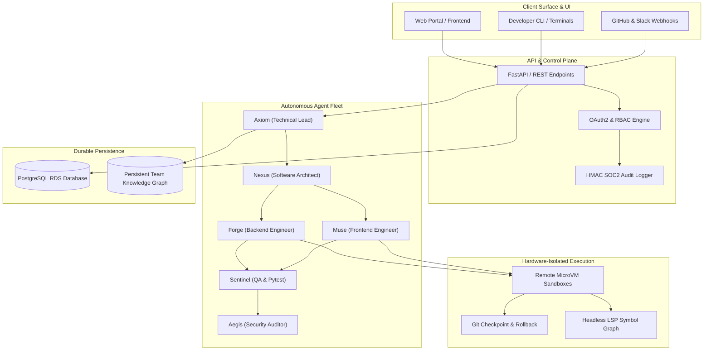

# Executive Architecture & Codebase Discovery Audit
**Project:** Kobits Platform  
**Audit ID:** `audit_20261016_201446`  
**Date:** 2026-10-16  
**Generated By:** Kobits Autonomous Engineering Platform (`HeadlessLSPService` + `Aegis Security Engine`)

---

## 1. Executive Summary
The Kobits Platform codebase comprises 762,213 lines of code across 458 files. Overall architectural health is scored at 20/100 (High Tech Debt / Requires Remediation). Our autonomous discovery engine identified 19 security item(s) and 109 high-complexity hotspot file(s). A structured 4-Week Milestone Sprint Roadmap has been established to systematically eliminate tech debt, harden test coverage, and deliver planned outcomes.

```text
╔═════════════════════════════════════════════════════════════════════════════╗
║                      OVERALL CODEBASE HEALTH SCORE:  20/100                     ║
╚═════════════════════════════════════════════════════════════════════════════╝
```

---

## 2. Technology Stack & Framework Inventory

| Category | Component / Library | Version / Status |
| :--- | :--- | :--- |
| **Backend Framework** | FastAPI | `Installed` |
| **Database ORM** | SQLAlchemy | `Installed` |
| **Data Validation** | Pydantic | `Installed` |
| **Containerization** | Docker | `Installed` |

---

## 3. Codebase Scale & Volume Breakdown

* **Total Source Files:** 458
* **Total Volume:** 762,213 physical lines of code
* **Test Code Volume:** 29,553 LOC (105 test files)
* **Estimated Test Coverage Ratio:** 3.9%

### Language Distribution
| Language | Volume (Lines) | Percentage |
| :--- | :--- | :--- |
| **Other** | 641,771 LOC | 84.2% |
| **Python** | 89,218 LOC | 11.7% |
| **JavaScript** | 15,017 LOC | 2.0% |
| **HTML** | 8,003 LOC | 1.0% |
| **CSS** | 4,929 LOC | 0.6% |
| **Markdown** | 1,722 LOC | 0.2% |
| **YAML** | 379 LOC | 0.0% |
| **TypeScript** | 351 LOC | 0.0% |

---

## 4. Architectural System Topography

The diagram below reflects the extracted dependency DAG and multi-agent governance layers:



---

## 5. Complexity Hotspots & Monolith Analysis

The following files represent high-complexity density (>350 LOC) prioritized for structural modularization:

| File Path | Lines of Code | Primary Language |
| :--- | :--- | :--- |
| `kobits.db` | 623,037 | Other |
| `training_data/kobits_frontier_v2.jsonl` | 4,851 | Other |
| `kobits_cli.py` | 3,840 | Python |
| `web/js/app.js` | 3,030 | JavaScript |
| `js/app.js` | 3,019 | JavaScript |
| `backend/services/mission_runtime.py` | 2,955 | Python |
| `backend/services/sandbox_manager.py` | 2,880 | Python |
| `backend/services/tool_registry.py` | 1,994 | Python |
| `backend/services/lsp_service.py` | 1,962 | Python |
| `index.html` | 1,944 | HTML |

---

## 6. Security & Vulnerability Scan Findings

Automated static analysis across OWASP Top 10 vectors, hardcoded secrets, and dangerous APIs:

| Severity | Risk Description | Location | Remediation Target |
| :--- | :--- | :--- | :--- |
| **HIGH** | Hardcoded Secret Token | `app/config.py:145` | Remove hardcoded secret and load from secure environment variables or secret manager. |
| **HIGH** | Hardcoded Secret Token | `app/config.py:146` | Remove hardcoded secret and load from secure environment variables or secret manager. |
| **CRITICAL** | Subprocess with shell=True (Command Injection Risk) | `backend/api/v1/github.py:252` | Replace dynamic execution with structured parameterization and safe API calls. |
| **CRITICAL** | Subprocess with shell=True (Command Injection Risk) | `backend/api/v1/github.py:262` | Replace dynamic execution with structured parameterization and safe API calls. |
| **HIGH** | Dynamic Code Execution (exec) | `backend/api/v1/tools.py:332` | Replace dynamic execution with structured parameterization and safe API calls. |
| **HIGH** | Unsafe Code Evaluation (eval) | `backend/api/v1/tools.py:332` | Replace dynamic execution with structured parameterization and safe API calls. |
| **HIGH** | Dynamic Code Execution (exec) | `js/ui.js:181` | Replace dynamic execution with structured parameterization and safe API calls. |
| **HIGH** | Dynamic Code Execution (exec) | `js/ui.js:188` | Replace dynamic execution with structured parameterization and safe API calls. |
| **HIGH** | Hardcoded Secret Token | `scripts/extract_training_dataset.py:160` | Remove hardcoded secret and load from secure environment variables or secret manager. |
| **HIGH** | Dynamic Code Execution (exec) | `security/audit_scripts/owasp_audit_checks.py:314` | Replace dynamic execution with structured parameterization and safe API calls. |

---

## 7. Managed 4-Week Milestone Roadmap (Sprint Engagements)

### Week 1: Discovery, Architecture Mapping & CI Hardening
* **Primary Focus**: Automated AST symbol indexing, dependency pruning, and headless test sandbox verification.
* **Status**: `IN_PROGRESS`
* **Deliverables**:
  - Complete Headless LSP Symbol Reference Graph extraction
  - Security audit resolution for hardcoded credentials & unsafe execution patterns
  - Automated negative-to-positive TDD reproducer pipeline integration

### Week 2: Core Service Refactoring & Hotspot De-risking
* **Primary Focus**: Decomposing high-complexity hotspot files (>500 LOC) and strengthening database abstractions.
* **Status**: `PLANNED`
* **Deliverables**:
  - Modularization of primary service entrypoints into isolated domain layers
  - ACID transaction safety and database connection pool optimization
  - Persistent team memory sync across architectural decision records (ADR)

### Week 3: Parallel Multi-Agent Feature Implementation
* **Primary Focus**: Simultaneous backend API and responsive frontend component synthesis in isolated MicroVMs.
* **Status**: `PLANNED`
* **Deliverables**:
  - Parallel execution waves via Forge (Backend) and Muse (Frontend)
  - Live ephemeral port tunneling and WebSocket HMR dev server previews
  - End-to-end integration test coverage across all critical user journeys

### Week 4: Verification Wave, Visual QA & Production Release
* **Primary Focus**: Multi-modal visual regression checks, OWASP penetration sweep, and zero-defect PR delivery.
* **Status**: `PLANNED`
* **Deliverables**:
  - Playwright headless browser verification across Desktop, Tablet, and Mobile viewports
  - HMAC-SHA256 SOC2 Type II compliance audit report export
  - Clean, peer-reviewed Pull Requests delivered with passing CI verification proofs


---
*Report certified by Kobits Autonomous Engineering Platform. All changes subject to 4-Stage Pre-Review Verification & Hardware MicroVM Isolation.*
